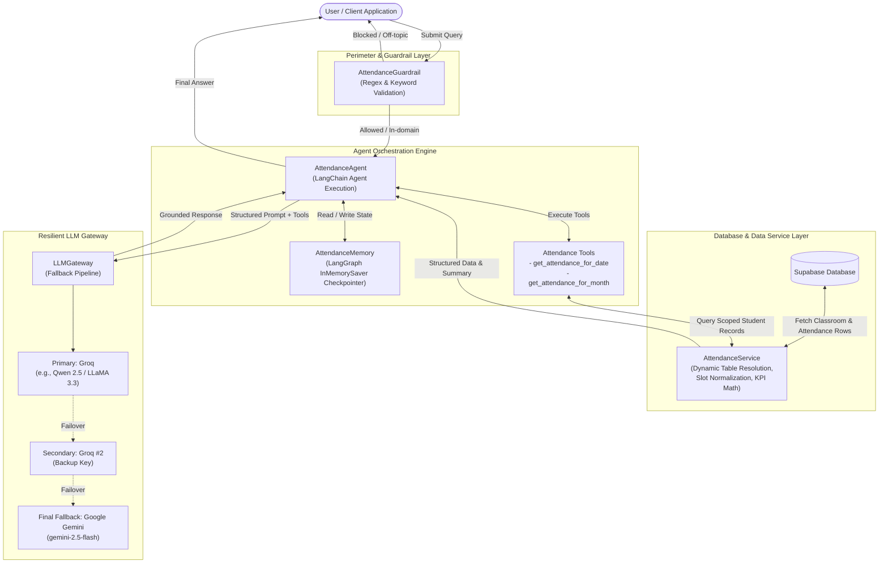
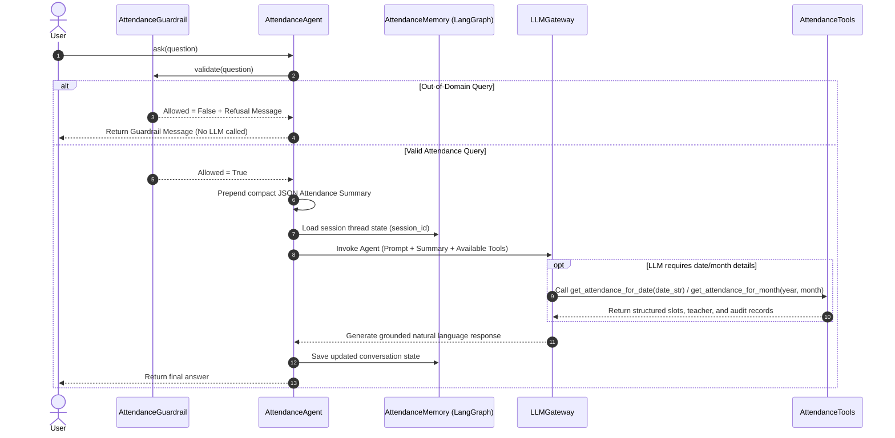
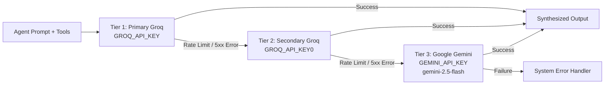
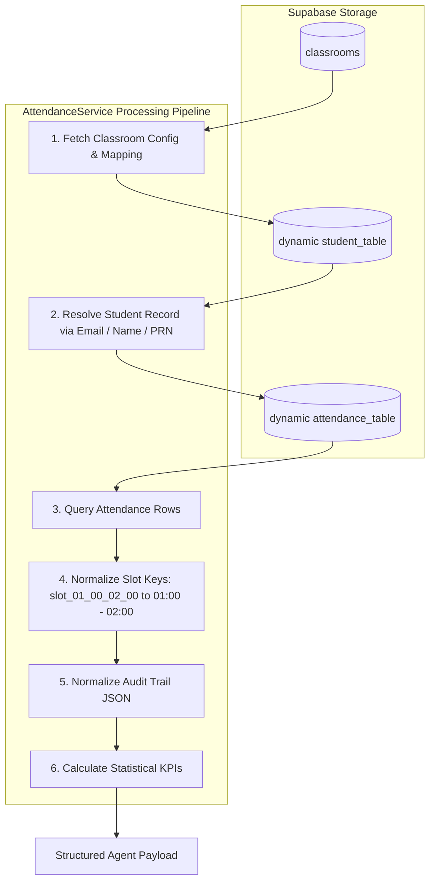

# CampusOS Attendance Agent

An enterprise-grade, deterministic AI agent designed for conversational attendance intelligence, slot-by-slot analysis, and predictive academic standing modeling.

---

## 📖 Overview

The **Attendance Agent** is a specialized conversational intelligence system within CampusOS that provides students and administrators with accurate, grounded, and instant insights into attendance records.

Instead of navigating rigid, multi-nested institutional ERP tables, users interact with an autonomous LangChain/LangGraph agent. The system pairs database records from Supabase with a multi-tiered Large Language Model (LLM) pipeline, strict deterministic guardrails, structured memory checkpointing, and dynamic tool calling.

### Core Objectives & Principles

* **Zero-Hallucination Guarantee**: The agent operates strictly on retrieved database records. It never guesses, interpolates, or extrapolates attendance counts.
* **Deterministic Guardrailing**: Out-of-domain queries (e.g., general knowledge, coding questions, chit-chat) are intercepted at the perimeter before invoking the LLM, preserving system focus and reducing latency.
* **Failover Resilience**: Multi-tiered LLM routing automatically fails over across redundant provider keys and fallback models without interrupting user sessions.
* **Granular Transparency**: Supports fine-grained analysis down to specific dates, individual time slots, assigned faculty members, and modification audit trails.
* **Predictive Forecasting**: Provides mathematical modeling for attendance recovery requirements and safe bunk thresholds.

---

## 🏗️ System Architecture

The Attendance Agent is architected with modular separation of concerns: input validation, data processing, memory management, tool execution, and resilient LLM generation.



---

## 🔄 Query Execution Lifecycle

When a user submits a question to the agent, it follows a strict multi-step execution pipeline:



---

## 🧩 Core Components

### 1. Agent Engine (`AttendanceAgent`)

The central coordinator implementing a LangChain ReAct agent equipped with tool calling and conversation checkpointing.

* **Context Injection**: Pre-injects a compact JSON representation of the student's high-level attendance summary into every prompt, allowing the LLM to answer summary questions instantly without making tool calls.
* **Deterministic System Instructions**:
  * Mandatory tool usage for any specific date queries.
  * Prohibition of data fabrication or extrapolation.
  * Non-attendance queries strictly filtered out.
  * Exclusion of pending/unmarked sessions from percentage calculations.
* **Error Resilience**: Catches runtime exceptions and returns graceful fallback feedback.

---

### 2. Guardrail Subsystem (`AttendanceGuardrail`)

Performs deterministic lexical and syntactic validation before invoking the LLM.

```mermaid
flowchart TD
    Input[Incoming User Query] --> EmptyCheck{Is Query Empty?}
    EmptyCheck -- Yes --> RejectEmpty[Reject: Empty query message]
    EmptyCheck -- No --> Tokenize[Tokenize into word set]
    
    Tokenize --> KeywordCheck{Matches Attendance\nKeywords?}
    KeywordCheck -- Yes --> Allow[Allow Query]
    KeywordCheck -- No --> DateCheck{Contains Date Pattern?\n\d{1,4}[-/]\d{1,2}[-/]\d{1,4}}
    
    DateCheck -- Yes --> Allow
    DateCheck -- No --> TimeCheck{Contains Time Pattern?\n\d{1,2} am/pm}
    
    TimeCheck -- Yes --> Allow
    TimeCheck -- No --> RejectOffTopic[Reject: Domain boundary message]
```

* **Keyword Lexicon**: Recognizes attendance concepts (`attendance`, `present`, `absent`, `slot`, `teacher`, `professor`, `faculty`, `percentage`, `audit`, `history`, `today`, `yesterday`, etc.).
* **Regex Pattern Matchers**: Identifies calendar dates (`YYYY-MM-DD`, `DD/MM/YYYY`) and clock times (`10am`, `2 pm`, `01:00`).
* **Boundary Enforcement**: Queries lacking domain keywords, dates, or time tokens receive an immediate refusal without consuming LLM API tokens.

---

### 3. Resilient LLM Gateway (`LLMGateway`)

Provides fault-tolerant model routing using LangChain's `.with_fallbacks()` mechanism.



* **Primary Provider**: High-speed Groq inference (e.g., `qwen/qwen3.6-27b` or configured model) set at `temperature=0` for maximum determinism.
* **Secondary Provider**: Alternate Groq credential pool to prevent service interruptions caused by rate limits.
* **Tertiary Fallback**: Google Gemini (`gemini-2.5-flash`), guaranteeing service availability during major upstream outages.
* **Judge LLM Factory**: Provides an extensible evaluation interface (`create_judge()`) for future automated quality benchmarking.

---

### 4. Grounded Tool System (`attendance_tools`)

The agent is provided with scoped Python tools executing directly against the student's in-memory record dataset:

| Tool Name | Parameters | Purpose | Return Structure |
| :--- | :--- | :--- | :--- |
| `get_attendance_for_date` | `date_str: str` *(YYYY-MM-DD)* | Queries exact attendance for a specific calendar date. | `{found: bool, date: str, slots: list, audit: list}` |
| `get_attendance_for_month` | `year: int, month: int` | Filters and aggregates all records belonging to a calendar month. | `{ "<YYYY-MM-DD>": {date, slots, audit}, ... }` |

#### Tool Data Isolation
* Tools are instantiated via a factory function (`create_attendance_tools(data)`), binding tool execution strictly to the active student's dataset.
* Tools do not execute raw SQL queries; they access sanitized in-memory data structures.

---

### 5. Attendance Service & Data Transformation (`AttendanceService`)

Manages database communication with Supabase and transforms raw database tables into normalized data structures.



#### Dynamic Table Resolution
Institutions often store students and attendance in classroom-specific tables. The service dynamically inspects the `classrooms` catalog:
1. Queries `classrooms` table using `classroom_id` and `college_id`.
2. Extracts dynamic table names: `classroom_table` (student registry) and `attendance_table` (daily logs).
3. Resolves the student by PRN, email, or name.
4. Retrieves attendance history ordered chronologically by `attendance_date`.

#### Slot & Audit Normalization
* **Slot Key Transformation**: Converts database columns (e.g., `slot_09_00_10_00`, `slot_01_00_02_00`) into readable string ranges (`09:00 - 10:00`, `01:00 - 02:00`).
* **Teacher Mapping**: Extracts faculty metadata from corresponding `slot_XX_XX_XX_XX_teacher` fields.
* **Audit Normalization**: Safely decodes JSON or list-based audit logs capturing historical edits and updates.

#### Mathematical Metric Formulas
The service calculates attendance percentages strictly on marked records:

$$\text{Marked Slots} = \text{Present Slots} + \text{Absent Slots}$$

$$\text{Attendance Percentage} = \begin{cases} \text{round}\left(\frac{\text{Present Slots}}{\text{Marked Slots}} \times 100, 2\right) & \text{if } \text{Marked Slots} > 0 \\ 0 & \text{otherwise} \end{cases}$$

> [!NOTE]
> Sessions marked as `pending` or unmarked are excluded from the denominator to avoid penalizing students for upcoming or unrecorded periods.

---

### 6. Conversation Memory (`AttendanceMemory`)

* Utilizes LangGraph's `InMemorySaver` checkpointer.
* Manages isolated conversation threads partitioned by `session_id` (`thread_id`).
* Retains conversational context across multi-turn interactions (e.g., `"Was I present yesterday?"` followed by `"Who was the teacher for the second slot?"`).

---

### 7. Analytical & Predictive Forecasting Engine

In addition to conversational Q&A, the system incorporates mathematical forecasting algorithms:

```mermaid
flowchart TD
    CurrentStats["Current Attendance State\n(Present: P, Absent: A, Total Marked: M)"]
    TargetSlider["Target Attendance Percentage\n(e.g., T = 75%)"]

    CurrentStats & TargetSlider --> RecoveryCalc{"Current % < Target %?"}
    
    RecoveryCalc -- Yes --> NeededCalc["Classes Needed to Recover Criteria\nC = ceil( (T*M - 100*P) / (100 - T) )"]
    RecoveryCalc -- No --> SkipCalc["Safe Skips / Bunks Allowed\nS = floor( (100*P - T*M) / T )"]
    
    NeededCalc --> MilestoneTable[Milestone Tracking Table\n75%, 80%, 85%, 90%, 95%]
    SkipCalc --> MilestoneTable
    MilestoneTable --> StatusGrading[Academic Standing Grade\nExcellent | Good | Warning | Critical]
```

#### Recovery Formula (Classes Needed)
To achieve target percentage $T$ ($T < 100$):

$$\text{Classes Needed} = \left\lceil \frac{T \cdot M - 100 \cdot P}{100 - T} \right\rceil$$

#### Safe Buffer Formula (Bunks Allowed)
When current percentage $\ge T$:

$$\text{Safe Skips} = \left\lfloor \frac{100 \cdot P - T \cdot M}{T} \right\rfloor$$

#### Academic Standing Grades
* $\ge 85\%$: **Excellent**
* $\ge 75\%$: **Good (Above Criteria)**
* $\ge 65\%$: **Warning (At Risk)**
* $< 65\%$: **Critical (Debarment Risk)**

---

## 📊 Data Models & Schema Reference

### 1. Processed Student Attendance Object

```json
{
  "success": true,
  "student": {
    "name": "Jane Doe",
    "email": "jane.doe@campus.edu",
    "prn": "PRN-2026-0042"
  },
  "college_id": 1,
  "classroom_id": 6,
  "classroom_name": "Computer Science - Division A",
  "class_teacher": "Dr. Alan Turing",
  "summary": {
    "present": 28,
    "absent": 4,
    "pending": 2,
    "total_slots": 34,
    "marked_slots": 32,
    "attendance_percentage": 87.5
  },
  "attendance": {
    "2026-03-20": {
      "date": "2026-03-20",
      "slots": [
        {
          "slot": "09:00 - 10:00",
          "status": "present",
          "teacher": "Prof. Smith"
        },
        {
          "slot": "10:00 - 11:00",
          "status": "absent",
          "teacher": "Prof. Davis"
        }
      ],
      "audit": [
        {
          "timestamp": "2026-03-20T10:05:00Z",
          "modified_by": "Prof. Davis",
          "action": "marked_absent"
        }
      ]
    }
  }
}
```

### 2. Guardrail Result Structure

```json
{
  "allowed": false,
  "message": "I can only help with your attendance, classes, slots, teachers, or attendance history."
}
```

---

## 💬 Supported Query Capabilities

| Category | Example User Query | Handling Strategy |
| :--- | :--- | :--- |
| **Overall Summary** | *"What is my current attendance percentage?"* | Answered directly from pre-injected summary without tool overhead. |
| **Specific Date Status** | *"Was I present on March 20, 2026?"* | Invokes `get_attendance_for_date("2026-03-20")` to inspect slot statuses. |
| **Time-Slot Lookup** | *"Did I attend the 01:00 - 02:00 class yesterday?"* | Fetches the target date and matches slot timestamps. |
| **Faculty Inquiries** | *"Who taught the 10:00 AM class on Friday?"* | Resolves teacher metadata from the date record's slot details. |
| **Monthly Aggregate** | *"Show my attendance record for March 2026."* | Calls `get_attendance_for_month(2026, 3)` to aggregate monthly records. |
| **Audit & History** | *"Was my attendance on March 15 altered later?"* | Inspects the `audit` array returned by `get_attendance_for_date`. |
| **Off-Topic Protection** | *"Write Python code for quicksort."* | Intercepted by `AttendanceGuardrail` with zero LLM consumption. |
