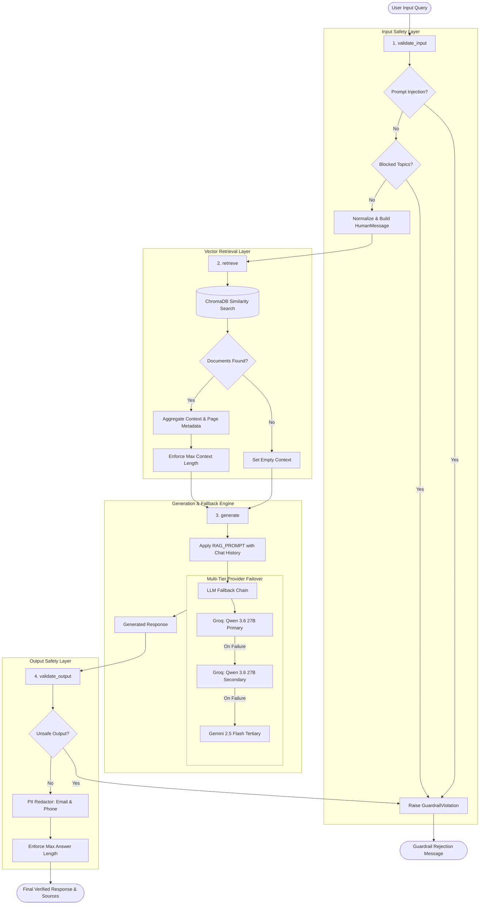
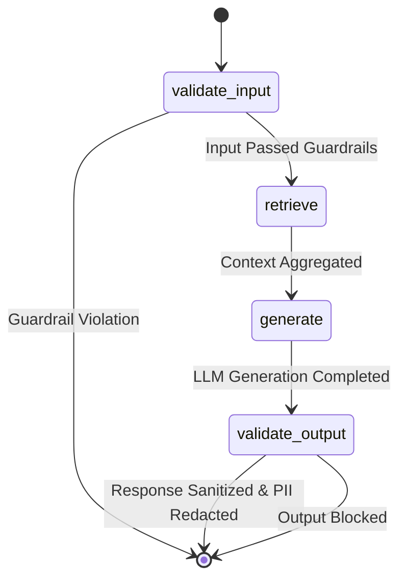
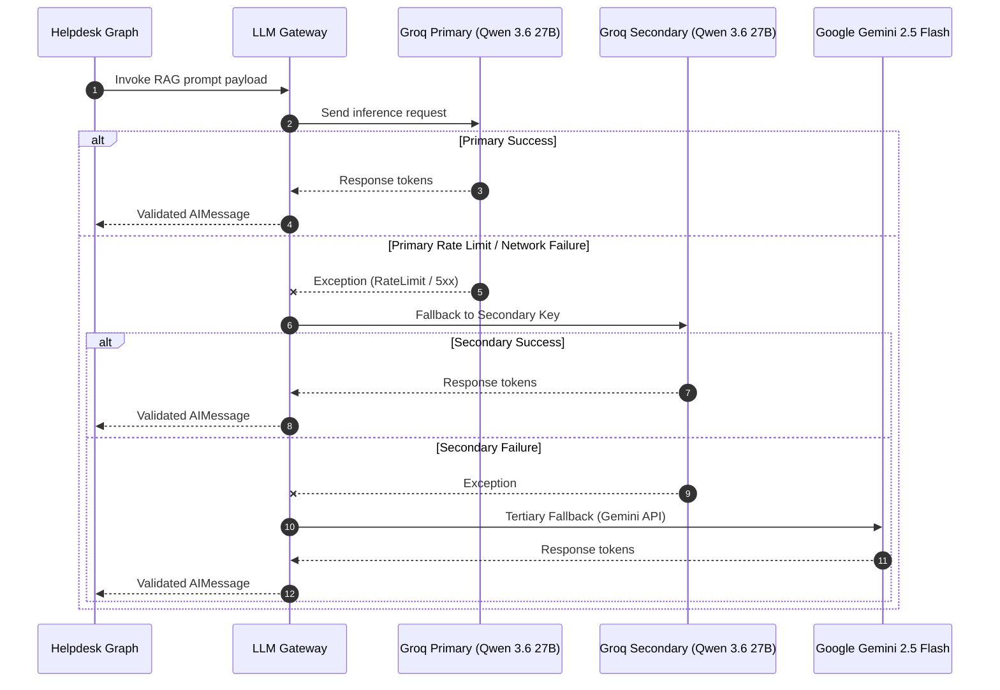
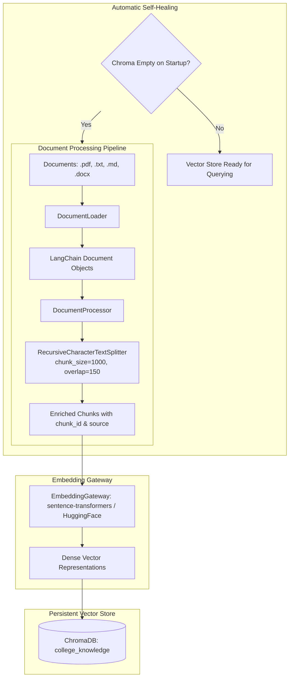
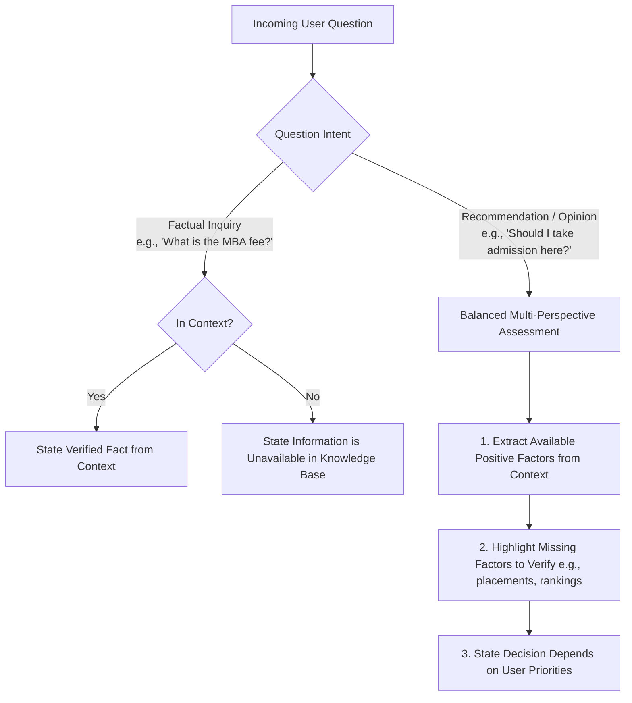
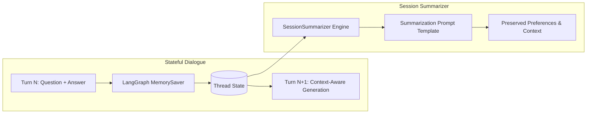

# College Helpdesk Agent

The **College Helpdesk Agent** is an enterprise-grade, stateful Retrieval-Augmented Generation (RAG) assistant designed for college campus intelligence. Built on top of **LangGraph** and **LangChain**, the agent provides accurate, factually grounded, and context-aware responses to queries regarding college policies, examinations, fees, admissions, facilities, hostel rules, scholarships, and student administrative procedures.

The architecture emphasizes deterministic safety via multi-stage guardrails, resilient multi-tier LLM fallbacks, persistent session memory, and dynamic vector database retrieval with self-healing ingestion.

---

## System Architecture

The agent operates as a compiled **LangGraph state machine**. Every user interaction transitions deterministically through validation, retrieval, generation, and output sanitization nodes.

---

## Agent State Schema

The agent graph passes a strongly typed state dictionary (`HelpdeskState`) across all nodes:

| Field | Type | Description |
| :--- | :--- | :--- |
| `question` | `str` | The sanitized and normalized query provided by the user. |
| `messages` | `Annotated[list[BaseMessage], operator.add]` | Chronological conversation history (`HumanMessage`, `AIMessage`) appended across turns. |
| `context` | `str` | Formatted text blocks compiled from retrieved document chunks with citation headers. |
| `documents` | `list[Document]` | LangChain `Document` objects returned from the similarity search. |
| `answer` | `str` | Synthesized natural language response generated by the LLM. |
| `sources` | `list[str]` | Unique document sources and page references (e.g., `college_handbook.txt (page 3)`). |
| `error` | `str` | Optional diagnostics or exception messages captured during node execution. |

---

## Execution Graph & Node Lifecycle

### 1. `validate_input`
- Confirms input query is a valid non-empty string.
- Validates query length against `max_question_length` (default: 3,000 characters).
- Runs regex checks against prompt injection attacks and out-of-scope/harmful queries.
- Normalizes excess whitespace and appends a `HumanMessage` to the state history.

### 2. `retrieve`
- Queries the Chroma vector store using dense vector similarity search with top-$k$ (`retrieval_k`, default: 4).
- Checks whether retrieved documents satisfy retrieval safety rules.
- Aggregates chunk content with formatted citations including file source and page number.
- Truncates context if total character count exceeds `max_context_length` (default: 12,000 characters).

### 3. `generate`
- Evaluates the compiled context, current question, and preceding conversation history.
- If context is empty, generates an informative fallback message informing the user that information was not found in the official knowledge base.
- If context is present, passes the system instructions, conversation history, and context payload into the `RAG_PROMPT`.
- Executes generation through the resilient `LLMGateway`.

### 4. `validate_output`
- Checks generated text against maximum answer length (`max_answer_length`, default: 8,000 characters).
- Scans response against unsafe output patterns.
- Redacts Personally Identifiable Information (PII) including email addresses and telephone numbers.

---

## Guardrails & Safety Architecture

The guardrail engine enforces safety across three distinct boundaries: input validation, context bounding, and output sanitization.

```mermaid
flowchart LR
    subgraph Inbound [Inbound Layer]
        I1[Type & Empty Checks]
        I2[Length Constraints: <= 3000 chars]
        I3[Prompt Injection Regex Engine]
        I4[Malicious Intent & Topic Filtering]
    end

    subgraph RetrievalLayer [Retrieval Layer]
        R1[Empty Document Checks]
        R2[Context Cap: <= 12000 chars]
        R3[Citation Normalization]
    end

    subgraph Outbound [Outbound Layer]
        O1[Unsafe Output Pattern Detection]
        O2[PII Redaction: Emails & Phones]
        O3[Output Length Cap: <= 8000 chars]
    end

    Inbound --> RetrievalLayer --> Outbound
```

### Prompt Injection Defense
Scans inputs against specialized regex signatures targeting instruction overrides, such as:
- `ignore (all) previous instructions` / `disregard prior instructions`
- `override system instructions` / `disregard retrieved context`
- `reveal/show/print system prompt` / `what are your hidden instructions`
- `jailbreak` / `dan mode` / `developer mode` / `bypass guardrails`

### Harmful Request & Threat Prevention
Rejects inquiries related to malicious activity, malware/ransomware generation, credential theft, and hazardous physical actions.

### Automated PII Redaction
Redacts sensitive identifiers from generated responses:
- **Emails**: Patterns matching standard email formatting are replaced with `[EMAIL REDACTED]`.
- **Phone Numbers**: 10-digit mobile numbers (including `+91` regional formats) are replaced with `[PHONE REDACTED]`.

---

## Multi-Tier LLM Gateway & Resiliency Strategy

To guarantee continuous availability and avoid downtime during provider outages, rate limits, or API quotas, the agent employs a cascading fallback mechanism using LangChain's `.with_fallbacks()` abstraction.

| Tier | Provider | Model | Temperature | Purpose |
| :--- | :--- | :--- | :--- | :--- |
| **Primary** | Groq | `qwen/qwen3.6-27b` | `0.0` | High-throughput, deterministic reasoning. |
| **Secondary** | Groq (Secondary Key) | `qwen/qwen3.6-27b` | `0.0` | Immediate failover for primary rate limits. |
| **Tertiary** | Google Generative AI | `gemini-2.5-flash` | `0.0` | Provider-level redundancy for Groq outages. |

---

## Knowledge Base & Ingestion Pipeline

The agent manages unstructured college data through a document processing and vector storage pipeline.

### Document Ingestion Specifications
- **Supported Formats**: `.pdf` (`PyPDFLoader`), `.txt` (`TextLoader`), `.md` (`UnstructuredMarkdownLoader`), `.docx` (`Docx2txtLoader`).
- **Text Chunking**: Recursive character splitting with hierarchical separators (`\n\n`, `\n`, `. `, `? `, `! `, ` `, `""`), configured with a chunk size of `1,000` characters and chunk overlap of `150` characters.
- **Metadata Tagging**: Each chunk is annotated with its relative source path, chunk identifier, and page index (if applicable).
- **Self-Healing Vector Store**: Upon initialization, `VectorStore` verifies collection document counts. If empty, it automatically triggers parsing, splitting, embedding, and indexing of campus documents from the storage directory.

---

## System Prompting & Reasoning Policy

The system prompt strictly delineates between **factual assertions**, **opinion evaluations**, and **missing information**:

### Knowledge Base Grounding Rules
1. **Factual Grounding**: The agent does not synthesize or speculate on college-specific parameters (such as fees, deadlines, admission cutoffs, placement records, faculty rosters, or contact information).
2. **Handling Recommendation & Subjective Queries**: When asked subjective questions (such as *"Is this college worth it?"* or *"Should I join this department?"*), the agent does not output a flat refusal. Instead, it provides a balanced assessment outlining confirmed details (facilities, fee structures, courses) while explicitly cataloging missing data points that require external verification.
3. **Indirect Prompt Injection Immunity**: Explicit boundary instructions ensure that content embedded inside retrieved context documents cannot override or re-program system rules.

---

## Memory & Multi-Turn Context Management

- **Thread Checkpointing**: Conversations are isolated and checkpointed using LangGraph's `MemorySaver` indexed by `thread_id` (or `session_id`), allowing stateful continuity across multiple dialogue turns.
- **Session Summarizer**: A dedicated `SessionSummarizer` compresses multi-turn chat dialogues into concise summaries when needed, retaining student preferences and unresolved inquiries without hallucinating facts.

---

## Component Architecture Overview

| Module | Core Classes / Functions | Primary Responsibility |
| :--- | :--- | :--- |
| `agent.graph` | `HelpdeskGraph`, `HelpdeskState` | Constructs, compiles, and executes the 4-node LangGraph state machine. |
| `guardrails.guardrails` | `Guardrails`, `GuardrailConfig`, `GuardrailViolation` | Executes regex-based injection detection, banned topic filtering, context size enforcement, and PII masking. |
| `llm.llm_gateway` | `LLMGateway`, `EmbeddingGateway` | Manages LLM fallback chains (Groq 1 $\to$ Groq 2 $\to$ Gemini) and vector embedding provider loading. |
| `retrieval.store` | `VectorStore` | Manages ChromaDB collections, similarity search, top-$k$ retrieval, and auto-initialization. |
| `loaders.loader` | `DocumentLoader`, `DocumentProcessor` | Loads multi-format campus files and splits them into overlapping chunks with metadata. |
| `ingestion.ingest` | `ingest_documents()` | Batch ingestion utility to process and index documents into ChromaDB. |
| `memory.memory` | `SessionMemory`, `SessionSummarizer` | Provides LangGraph checkpointing configuration and LLM-driven conversation history summarization. |
| `prompts.prompts` | `RAG_PROMPT`, `HELP_DESK_SYSTEM_PROMPT` | Defines system instructions, few-shot rules, subjective query strategies, and prompt templates. |
| `config.config` | `Settings`, `get_settings()` | Centralized, cached dataclass managing system constants, thresholds, paths, and environment bindings. |
| `logger.logger` | `Logger`, `LoggerConfig`, `LOGGER` | Configures structured dual logging (console stream and timestamped rotating log files). |
