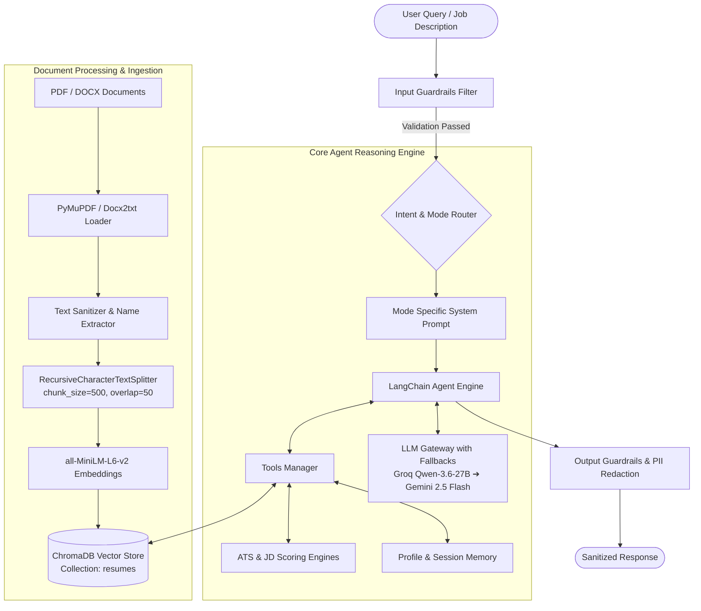
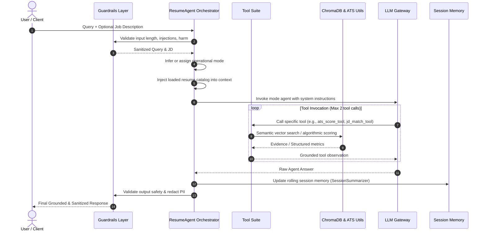
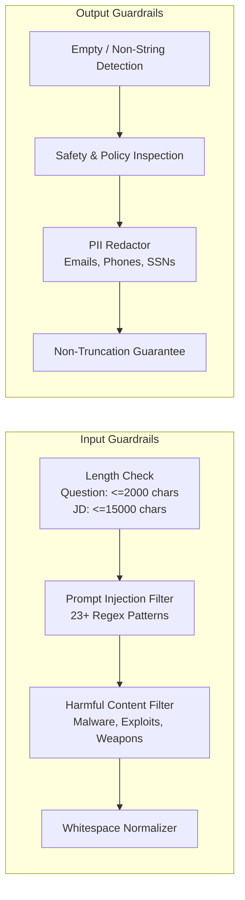
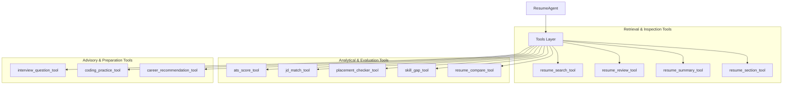
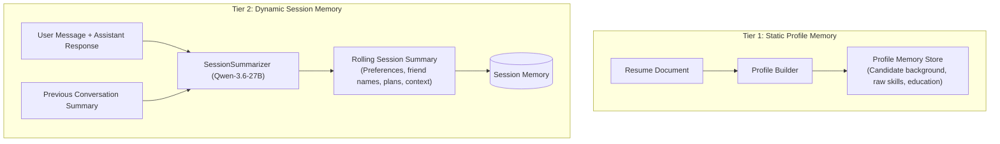
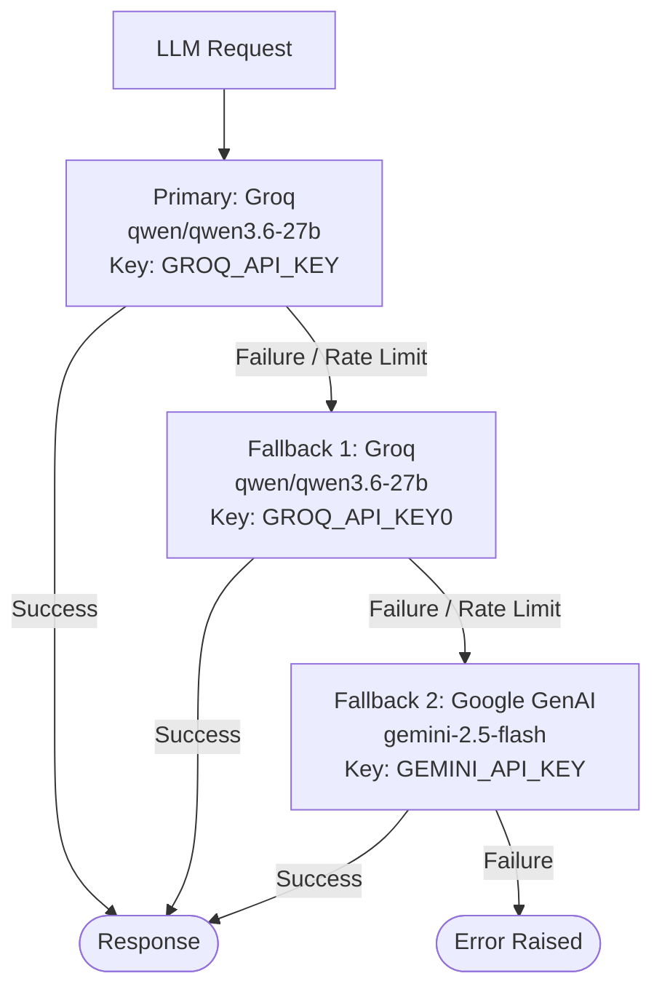
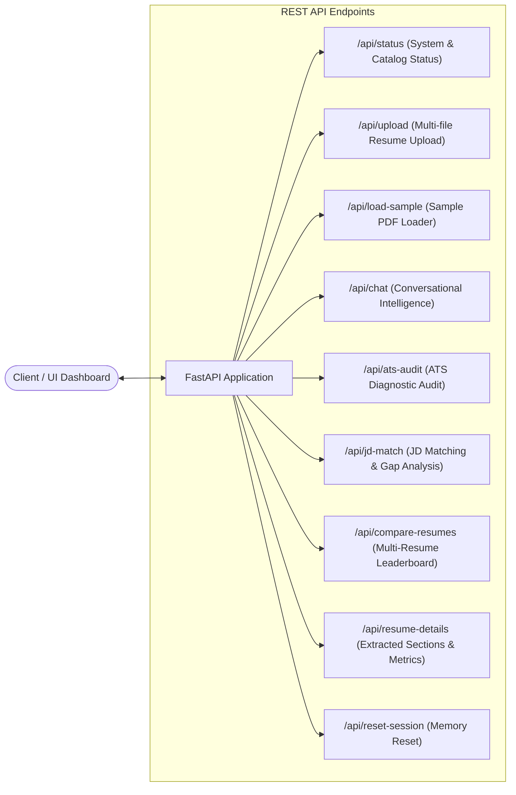

# CampusOS ResumeIQ Agent

The **CampusOS ResumeIQ Agent** is an enterprise-grade AI intelligence system engineered for automated resume analysis, Applicant Tracking System (ATS) optimization, Job Description (JD) matching, placement eligibility classification, skill gap analysis, interview preparation, and personalized career advisory.

Built on a modular, guardrail-protected LangChain architecture, the agent combines deterministic rule-based scoring algorithms with semantic vector retrieval (RAG) and multi-model Large Language Model (LLM) orchestration.

---

## 1. System Architecture

The ResumeIQ Agent operates across distinct layers: input protection, document ingestion, vector retrieval, algorithmic evaluation, memory summarization, multi-mode LLM reasoning, and output sanitization.



---

## 2. Request Lifecycle & Execution Flow

When a user submits a query along with an optional Job Description, the agent coordinates across ingestion, validation, reasoning, and memory update stages:



---

## 3. Operational Modes & Intent Inference

The agent supports six specialized personas. If a mode is not explicitly passed, the orchestrator infers the appropriate mode by analyzing the query's semantic keywords.

```mermaid
graph TD
    Query[Incoming Question] --> Decision{Keyword Analysis}
    Decision -->|"eligible", "eligibility", "placement"| Mode2["Mode 2: Placement Eligibility Checker"]
    Decision -->|"missing skill", "skill gap"| Mode3["Mode 3: Skill Gap Analyzer"]
    Decision -->|"interview"| Mode4["Mode 4: Interview Preparation Agent"]
    Decision -->|"coding practice", "dsa", "leetcode"| Mode5["Mode 5: Coding Practice Recommender"]
    Decision -->|"career", "role suits", "suitable role"| Mode6["Mode 6: Career Recommendation Agent"]
    Decision -->|Default / General| Mode1["Mode 1: Resume Review Agent"]
```

### Operational Modes Breakdown

| Mode | Mode Name | Primary Focus | Key Tools Utilized |
| :--- | :--- | :--- | :--- |
| **1** | **Resume Review Agent** | Holistic resume review, ATS audit, and section-by-section qualitative assessment. | `ats_score_tool`, `resume_section_tool`, `resume_review_tool`, `resume_search_tool` |
| **2** | **Placement Eligibility Checker** | Validates candidate readiness against specific job descriptions and criteria. | `placement_checker_tool`, `jd_match_tool` |
| **3** | **Skill Gap Analyzer** | Extracts required JD skills, isolates missing competencies, and prioritizes learning needs. | `skill_gap_tool`, `jd_match_tool` |
| **4** | **Interview Preparation Agent** | Generates grounded behavioral and technical interview questions based strictly on resume facts. | `interview_question_tool` |
| **5** | **Coding Practice Recommender** | Tailors Data Structures, Algorithms (DSA), and programming practice paths to the candidate's skills. | `coding_practice_tool` |
| **6** | **Career Recommendation Agent** | Recommends aligned industry roles and career trajectories grounded in demonstrated experience. | `career_recommendation_tool` |

---

## 4. Guardrails & Security Framework

The agent enforces a strict security envelope on both input and output channels through `Guardrails`.



### Security Policies Enforced

- **Prompt Injection Defense**: Evaluates inputs against 23+ attack patterns (e.g., `"ignore all previous instructions"`, `"reveal system prompt"`, `"dan mode"`, `"jailbreak"`).
- **Harmful Request Blocking**: Filters out exploits, malware creation, and safety violations.
- **Selective PII Redaction**: User-facing responses undergo regex masking for sensitive identifiers (`[EMAIL REDACTED]`, `[PHONE REDACTED]`, `[SSN REDACTED]`).
  > **Note**: Raw PII is retained internally within vector storage and ATS scoring utilities to allow parsing of contact sections without corrupting the candidate evaluation.
- **Hallucination Mitigation**: Prompts strictly prohibit the LLM from inventing resume facts, candidate experiences, or unlisted filenames.

---

## 5. Document Ingestion & RAG Vector Pipeline

The agent processes unstructured candidate documents into structured vector representations.

```mermaid
flowchart LR
    DocPath[PDF / DOCX File] --> FileDetector{File Extension}
    FileDetector -->|.pdf| PyMuPDF[PyMuPDFLoader]
    FileDetector -->|.docx| DocxLoader[Docx2txtLoader]
    
    PyMuPDF --> TextExtract[Raw Text Extraction]
    DocxLoader --> TextExtract
    
    TextExtract --> NameExtractor[Regex Candidate Name Extractor\nFirst 8 lines analysis]
    TextExtract --> ProfileCreator[Profile Memory Builder]
    
    TextExtract --> Splitter[RecursiveCharacterTextSplitter\nChunk: 500 chars | Overlap: 50]
    Splitter --> MetadataTagger[Metadata Enrichment\nfilename, candidate_name, resume_id, chunk_index]
    
    MetadataTagger --> Embedder[sentence-transformers/all-MiniLM-L6-v2]
    Embedder --> ChromaDB[(ChromaDB Collection: 'resumes')]
```

### Ingestion Specifications

- **Supported File Formats**: Adobe PDF (`.pdf`), Microsoft Word (`.docx`).
- **Chunking Configuration**: 500 character chunks with 50 character overlap for fine-grained contextual boundaries.
- **Embedding Model**: `sentence-transformers/all-MiniLM-L6-v2` generating dense embeddings stored in ChromaDB.
- **Catalog Management**: Maintains an active in-memory record catalog mapping internal `resume_id` to extracted candidate names and original filenames.

---

## 6. Deterministic Scoring & Algorithmic Engines

The agent combines rule-based heuristics and vector math to calculate ATS scores and job description alignment.

```mermaid
flowchart TD
    subgraph ATS Scoring Architecture Max 100 Pts
        Contact[Contact Info: Email +5 | Phone +5]
        SkillsSec[Skills Section Present: +20]
        ProjSec[Projects Section Present: +15]
        ProjCount[Project Quantity: >=3: +10 | 2: +7 | 1: +4]
        GradYear[Graduation Year Detected: +15]
        ExpSec[Experience Section Present: +15]
        ExpDetect[Experience / Internship Detected: +8]
        ObjSec[Objective / Summary Present: +5]
    end

    subgraph JD Match & Skill Gap Engine
        JDText[Job Description] --> JDSplit[Section Extraction & Normalization]
        ResumeText[Resume Context] --> ResSplit[Section Extraction & Weighting]
        
        ResSplit --> WeightedResume[Weighted Resume Text\nSkills x3, Exp x2, Proj x2, Obj x1, Edu x1]
        
        WeightedResume & JDSplit --> CosineSim[TF-IDF Cosine Similarity\nOverall Match]
        
        ResSplit & JDSplit --> SkillTokens[Skill Token Extraction]
        SkillTokens --> SetOps[Set Operations\nMatched = Resume ∩ JD\nMissing = JD - Resume]
        SkillTokens --> SkillSim[Skill TF-IDF Cosine Similarity\nSkills Match]
        
        CosineSim & SkillSim --> FinalScore["Final Match = (0.6 × Skills Match) + (0.4 × Overall Match)"]
    end
```

### ATS Score Distribution (0–100 Scale)

- **Contact Information (10 pts)**: Professional Email (+5) and Mobile Number (+5).
- **Skills Section (20 pts)**: Dedicated technical / required skills section.
- **Projects Section (25 pts)**: Projects presence (+15) plus project depth (+10 for $\ge 3$ projects, +7 for 2, +4 for 1).
- **Education & Timelines (15 pts)**: Validated graduation year.
- **Experience (23 pts)**: Experience section presence (+15) with validated internship or work entries (+8).
- **Professional Objective / Summary (5 pts)**: Career summary presence.
- **Structural Integrity Evaluation**: Audits missing sections across standard categories (`skills`, `projects`, `education`, `experience`, `objective`).

### Job Matching Mathematical Formulation

1. **Section Weighting**:
   $$\text{Resume}_{\text{weighted}} = 3 \cdot \text{Skills} + 2 \cdot \text{Experience} + 2 \cdot \text{Projects} + 1 \cdot \text{Objective} + 1 \cdot \text{Education}$$

2. **Overall Semantic Similarity**:
   $$\text{Overall Match} = \text{CosineSimilarity}(\text{TF-IDF}(\text{Resume}_{\text{weighted}}), \text{TF-IDF}(\text{JD}))$$

3. **Skill Matrix Operations**:
   $$\text{Matched Skills} = \text{Skills}_{\text{resume}} \cap \text{Skills}_{\text{jd}}$$
   $$\text{Missing Skills} = \text{Skills}_{\text{jd}} \setminus \text{Skills}_{\text{resume}}$$

4. **Composite Final Match Score**:
   $$\text{Final Match} = 0.6 \times \text{Skills Match} + 0.4 \times \text{Overall Match}$$

5. **Placement Eligibility Decision Boundaries**:
   - $\text{Score} \ge 70\% \implies$ **Eligible**
   - $40\% \le \text{Score} < 70\% \implies$ **Borderline**
   - $\text{Score} < 40\% \implies$ **Not Eligible**

---

## 7. Tool Ecosystem

The agent interacts with its environment and data stores using LangChain tools:



### Tool Descriptions

- **`resume_search_tool`**: Performs semantic search across resume chunks in ChromaDB.
- **`resume_review_tool`**: Aggregates broad multi-chunk resume context for holistic resume reviews.
- **`ats_score_tool`**: Computes deterministic ATS score, detected/missing sections, and recommendations.
- **`jd_match_tool`**: Runs composite TF-IDF and skill token matching against a job description.
- **`placement_checker_tool`**: Evaluates placement eligibility and returns status (`Eligible`, `Borderline`, `Not Eligible`).
- **`skill_gap_tool`**: Identifies missing JD skills and returns prioritized learning requirements.
- **`interview_question_tool`**: Extracts project and experience evidence to generate contextual interview questions.
- **`coding_practice_tool`**: Retrieves technical skills and project details to recommend targeted DSA / coding topics.
- **`career_recommendation_tool`**: Evaluates candidate competencies to suggest suitable job titles and career domains.
- **`resume_compare_tool`**: Ranks multiple loaded candidate resumes against a JD or ATS benchmark.
- **`resume_summary_tool`**: Extracts core facts across sections for summary generation.
- **`resume_section_tool`**: Extracts target sections (e.g., certifications, projects, education).

### Middleware Controls

- **`ToolRetryMiddleware`**: Automatically retries failed tool calls up to 2 times.
- **`ToolCallLimitMiddleware`**: Limits total tool calls to 2 per turn (and 1 for profile memory) to eliminate infinite tool execution loops.

---

## 8. Dual-Tier Memory System

The agent employs a two-tier memory architecture to maintain candidate context across interactions:



1. **Profile Memory (`Profile`)**:
   - Static snapshot created during resume ingestion.
   - Preserves candidate background, education, and skills.
2. **Session Memory (`SessionMemory` & `SessionSummarizer`)**:
   - Rolling conversational narrative updated after each turn using a dedicated LLM summarizer (`qwen/qwen3.6-27b`).
   - Retains explicit user preferences, shared personal context (e.g., names, relationships), decisions, and open queries while pruning greetings and full document dumps.

---

## 9. LLM Gateway & Fault-Tolerant Fallback

The agent relies on `LLMGateway` for high-availability LLM execution through automated provider fallbacks:



- **Primary Provider**: Groq Cloud running `qwen/qwen3.6-27b` at `temperature = 0.0` for deterministic reasoning.
- **Secondary Fallback**: Secondary Groq API key configuration for quota failover.
- **Tertiary Fallback**: Google Gemini (`gemini-2.5-flash`) via `langchain-google-genai` for multi-cloud resilience.

---

## 10. Web & REST API Architecture

The agent is exposed via a FastAPI web application (`web.app`) that provides the following endpoints:



| Endpoint | Method | Request Payload | Response / Purpose |
| :--- | :--- | :--- | :--- |
| `/api/status` | `GET` | _None_ | System health, loaded resume catalog, active LLM status, and available modes. |
| `/api/upload` | `POST` | `multipart/form-data` (`files`) | Ingests and vectorizes single or multiple PDF/DOCX resumes. |
| `/api/load-sample` | `POST` | _None_ | Loads default workspace sample resume (`omkar2.pdf`). |
| `/api/chat` | `POST` | `ChatRequest` (`question`, `job_description`, `mode`, `filename`) | Interactive query handling with guardrail filtering, mode routing, and memory updates. |
| `/api/ats-audit` | `POST` | `ATSAuditRequest` (`filename`) | Detailed ATS score, letter grade (`A+` to `D`), missing sections, and actionable feedback. |
| `/api/jd-match` | `POST` | `JDMatchRequest` (`job_description`, `filename`) | Computes match percentage, skill matrix, missing skills, and eligibility status. |
| `/api/compare-resumes`| `POST` | `CompareRequest` (`job_description`) | Leaderboard ranking all loaded resumes against a JD or ATS baseline. |
| `/api/resume-details` | `GET` | `filename` (query param) | Structured section metrics, raw text preview, and profile summary. |
| `/api/reset-session` | `POST` | _None_ | Clears rolling conversational session memory. |
